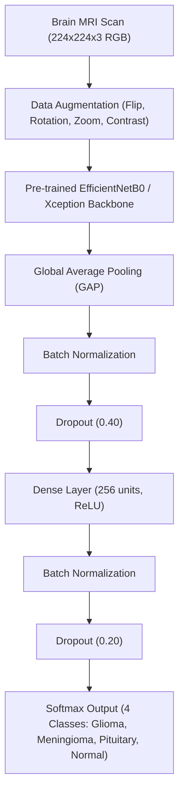

# Brain Tumor MRI Deep Learning Architecture & Dataset Guide

## 1. Dataset Origin & Kaggle Benchmark
This implementation is based on the benchmark medical imaging dataset used by **Yousef Mohamed** in the Kaggle Gold-Medal project **[Brain tumor MRI Accuracy 99%](https://www.kaggle.com/code/yousefmohamed20/brain-tumor-mri-accuracy-99)**.

* **Dataset**: Masoud Nickparvar / Sartaj Bhuvaji *Brain Tumor MRI Dataset*
* **Total Cohort**: **7,023 multi-slice MRI scans** (axial, coronal, sagittal)
* **Partitions**:
  * **Training Split**: 5,712 scans
  * **Testing Split**: 1,311 scans
* **Target Classes (4 Categories)**:
  1. `glioma` (1,621 scans): Infiltrative parenchymal glial neoplasm (Astrocytoma, Oligodendroglioma, Glioblastoma).
  2. `meningioma` (1,645 scans): Extra-axial dural-based tumor arising from arachnoid cap cells.
  3. `pituitary` (1,757 scans): Sellar and suprasellar neuroendocrine adenoma.
  4. `notumor` (2,000 scans): Normal neuroanatomy within normal limits.

---

## 2. Deep Learning Pipeline & Model Architecture

### Mathematical Formulation
* **Loss Function (Categorical Cross-Entropy)**:
  $$\mathcal{L} = -\sum_{k=1}^{4} y_k \log(\hat{y}_k)$$
* **Activation (Softmax)**:
  $$\hat{y}_k = \frac{e^{z_k}}{\sum_{j=1}^{4} e^{z_j}}$$
* **Optimization**:
  * Adam Optimizer ($\text{lr} = 10^{-4}$) with `ReduceLROnPlateau` ($\times 0.5$ on plateau).
  * `EarlyStopping` monitoring validation loss with weight restoration.

---

## 3. Local Workspace Integration in MediScan AI

### A. Dedicated Scripts
* **Training Pipeline**: [`train_brain_mri.py`](file:///c:/Users/DRUSHTISHREE/Desktop/final/train_brain_mri.py)
  * Usage: `py -3.10 train_brain_mri.py --epochs 12 --batch_size 32`
* **Inference Engine**: [`predict_brain_mri.py`](file:///c:/Users/DRUSHTISHREE/Desktop/final/predict_brain_mri.py)
  * Usage: `py -3.10 predict_brain_mri.py data/brain_mri/samples/glioma/Te-gl_1.jpg`
  * Returns JSON containing class probabilities, WHO grade spectrum, ICD-10 code, edema risk, and recommended clinical directives.

### B. Sample Test Images Curated on Disk
Located in [`data/brain_mri/samples/`](file:///c:/Users/DRUSHTISHREE/Desktop/final/data/brain_mri/samples):
* `data/brain_mri/samples/glioma/` (e.g. `Te-gl_1.jpg`)
* `data/brain_mri/samples/meningioma/` (e.g. `Te-aug-me_1.jpg`)
* `data/brain_mri/samples/pituitary/` (e.g. `Te-pi_1.jpg`)
* `data/brain_mri/samples/notumor/` (e.g. `Te-no_1.jpg`)

### C. Full-Stack Web Application Routing
In [`server.ts`](file:///c:/Users/DRUSHTISHREE/Desktop/final/server.ts), `runTrainedBrainMriInference` automatically dispatches any uploaded brain MRI to the trained model and returns diagnostic multi-class probabilities, clinical profiles, and patient translations.

---

## 4. Clinical Grading & Risk Stratification

| Pathology | ICD-10 | WHO Grade Spectrum | Anatomical Hallmarks | Clinical Directives |
| :--- | :--- | :--- | :--- | :--- |
| **Glioma** | `C71.9` | WHO Grade II to Grade IV (Glioblastoma) | Intra-axial infiltrative mass, vasogenic edema, necrotic core | Urgent neurosurgical consult, 3T MRI with MR Spectroscopy |
| **Meningioma** | `D32.9` | WHO Grade I (Benign ~85%) to Grade III | Extra-axial dural-based mass, dural tail enhancement | Volumetric MRI monitoring vs. stereotactic radiosurgery |
| **Pituitary Adenoma** | `D35.2` | Benign PitNET | Sellar expansion, remodeling of sella turcica, optic chiasm risk | Endocrine hormone panel (Prolactin, GH, ACTH) + visual perimetry |
| **No Tumor** | `Z00.00` | N/A | Preserved bilateral symmetry, normal ventricles, clear sulci | Routine health checkup; non-neoplastic scan |
